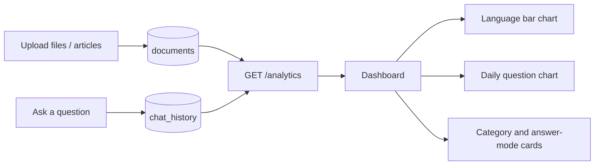

# Analytics and graphs

The frontend renders database-backed visualizations from `GET /analytics?days=14`.
- Documents by language: bar lengths proportionate to the number of records in each detected language.
- Questions per day: bars computed from saved chat entries (including "no documents found" questions), 14 days by default.
- Category mix: counts by document category.
- Answer modes: the number of responses generated by Groq versus local/extractive or no-context modes.

No personal identification, fake traffic, proprietary benchmark claims or external tracking service is used. Empty records yield 0-count metrics. The date buckets are based on database timestamps in UTC. The API limits the window to 90 days.
